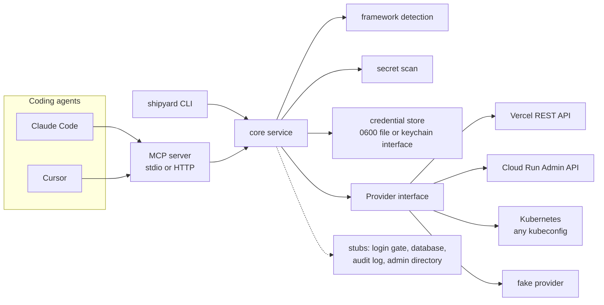

# Shipyard

With one command, or one prompt to a coding agent, an app built in an afternoon becomes a shareable internal tool.

People build internal tools with Claude Code, Cursor, or Lovable, then get stuck on the part that is not the app: deploying it, adding login, keeping secrets out of the repo, and taking backups. IT cannot see the app, and cannot approve it. Shipyard is a cloud for that small software. It does not host anything itself. It deploys onto a Vercel or Google Cloud account the company already has, behind one provider interface.

This repository is a Go core, a CLI, and an MCP server that coding agents can call. It deploys onto a Vercel account, a Google Cloud project, or a Kubernetes cluster the company already runs. The Kubernetes target documented here is UpCloud Managed Kubernetes.

## Architecture



The CLI and the MCP server call the same core. The core detects Next.js, Vite, Python, or Node, scans the tree for credentials, and calls a `Provider`. Vercel uses the deployments REST API. Cloud Run uses the generated Go clients for the Cloud Run Admin API and Cloud Logging. Kubernetes uses client-go against a kubeconfig you already have and creates a Deployment, a Service, and an Ingress for a prebuilt image. The fake provider records the app locally so you can try the flow without a cloud account. It is still the default.

The default region is `europe-west1`. Vercel maps EU locations to `arn1` (Stockholm). A Kubernetes deploy records that region unless you set a zone, for example UpCloud `fi-hel2`, on `shipyard connect`. The zone is a label. Shipyard does not create the cluster and does not pick a node.

## Connect your own account

Shipyard does not create Vercel or Google accounts.

Automatic account creation would break the providers' terms and be blocked by captchas and KYC checks. `ProvisionAccount` is a stub that returns `ErrNotSupported` on every provider. An operator connects an account they already own:

- a Vercel API token, or an OAuth code exchange
- a GCP access token or a service-account JSON key for an existing project, or an OAuth code exchange
- a kubeconfig for a Kubernetes cluster they already run, including an UpCloud Managed Kubernetes cluster

Tokens are stored in a file created with mode `0600` under the shipyard config directory (`$XDG_CONFIG_HOME/shipyard`, or `SHIPYARD_HOME`). A kubeconfig is not copied; only its path is stored. An OS keychain interface exists and returns "not implemented". The company still pays its own cloud bill, on the free tier where that applies. Shipyard never holds the hosting account.

The tradeoff is setup. Someone has to create the token or the service account once. In return, the deploy stays inside an account IT already governs, and a later admin view can list those apps without Shipyard becoming a second cloud.

## What works in this skeleton

| Piece | Today |
| --- | --- |
| `shipyard` CLI: `deploy`, `status`, `logs`, `secrets set`, `apps`, `connect`, `serve` | Works |
| `shipyard-mcp` tools: `deploy`, `status`, `logs`, `set_secret`, `list_apps` | Works, stdio |
| `shipyard serve`: status page, `/healthz`, `/readyz`, MCP on streamable HTTP | Works. Mutating tools require `SHIPYARD_HTTP_TOKEN` |
| Fake provider | Works, local JSON state, no network. Still the default |
| Vercel client: create deployment, list deployments, events, projects, env, OAuth URL and code exchange | Real HTTP client, tested with `httptest` |
| Cloud Run client: create or update a service, get, list, logs, env update, OAuth URL and code exchange | Go API clients, tested with `httptest` |
| Kubernetes provider: Deployment, Service, Ingress, status, logs, Secrets, list | client-go, tested with the fake clientset. Any kubeconfig. Does not build images |
| UpCloud helper | Prints how to download a kubeconfig. No API client |
| Dockerfile and `deploy/kubernetes` | Multi-stage static image, non-root, plus Deployment, Service, Ingress, probes |
| Framework detection | Next.js, Vite, Python, Node |
| Secret scan on deploy | Regex pass; deploy stops on a match |
| Credential file | Mode `0600` |
| EU default region | `europe-west1`, Vercel `arn1`. UpCloud zone default in the helper is `fi-hel2` |
| Login gate | Stub. Google Workspace or Microsoft sign-in, limited to the company domain |
| Database per app and backups | Stub |
| Audit log | In-memory only, so the call is wired. Not durable |
| Admin directory of apps and owners | Stub |
| OS keychain | Stub |
| `ProvisionAccount` | Stub, returns `ErrNotSupported` |
| Image build and push | Not built. `gcp` and `kubernetes` need a prebuilt image |
| TLS certificates for the Kubernetes Ingress | Not issued here. The Ingress names a secret; cert-manager or the platform fills it |
| Ankra API | Not called. Ankra reads this repo and deploys it |

Cloud Run deploys need a container image (`--image`). This tree does not build or push images, and it does not create GCP projects. New services are created with internal ingress and without a public invoker binding. The login gate that should sit in front of them is not built yet.

Kubernetes deploys need a prebuilt image too. The container is expected to listen on port 8080, and `PORT` is set to `8080`. `set_secret` writes a Kubernetes Secret and rolls the pod; the value is an environment variable, not a mounted file, and it is not written to the audit log. Shipyard does not create the cluster, the namespace's cloud account, or the TLS certificate.

A deploy to `vercel`, `gcp`, or `kubernetes` calls that provider. The default provider is `fake`, and the tests never call the production hosts.

## Quickstart

Requires Go 1.27 or newer. The MCP server uses the official Go SDK, `github.com/modelcontextprotocol/go-sdk` (v1.8.0, protocol 2026-07-28).

```bash
make build
./bin/shipyard connect fake
./bin/shipyard deploy hello --dir ./examples/hello
./bin/shipyard status hello
./bin/shipyard logs hello
./bin/shipyard secrets set hello API_KEY --value 'replace-me'
./bin/shipyard apps
PORT=8080 ./bin/shipyard serve
```

`connect fake` only writes a local marker. The URL it prints, `https://hello.fake.shipyard.local`, is not a real site. `serve` connects the fake provider in memory, listens on `$PORT` (default 8080), and does not call a cloud API.

### MCP

Build `shipyard-mcp` and point Claude Code or Cursor at the binary. The server reads the same config directory as the CLI, so connect a provider in the CLI first. Logs go to stderr. stdout is the MCP protocol.

Claude Code, `.mcp.json` at the project root:

```json
{
  "mcpServers": {
    "shipyard": {
      "command": "/absolute/path/to/shipyard-mcp"
    }
  }
}
```

Cursor, `.cursor/mcp.json`:

```json
{
  "mcpServers": {
    "shipyard": {
      "command": "/absolute/path/to/shipyard-mcp"
    }
  }
}
```

Then ask the agent to deploy the project. It should call `deploy`. For a dry run, say to use the fake provider.

`shipyard serve` exposes the same tools at `http://127.0.0.1:8080/mcp` on the streamable HTTP transport. Without `SHIPYARD_HTTP_TOKEN`, `deploy` and `set_secret` are not registered. With the token set, send `Authorization: Bearer <token>`. The status page at `/` stays public and lists app names and URLs, never secret values.

### A real provider

Create a token in the account you already own. Placeholders live in `.env.example`. Do not commit a real token.

```bash
export VERCEL_TOKEN=...   # from .env, not from this repo
./bin/shipyard connect vercel --token "$VERCEL_TOKEN"
./bin/shipyard deploy hello --provider vercel --dir ./examples/hello

export GCP_PROJECT=your-existing-project
export GCP_TOKEN=...
./bin/shipyard connect gcp --project "$GCP_PROJECT" --token "$GCP_TOKEN"
./bin/shipyard deploy hello --provider gcp --image example.com/hello:1

# Any kubeconfig. UpCloud is the documented default; see the section below.
./bin/shipyard connect kubernetes --kubeconfig "$HOME/.kube/config" --namespace apps --domain apps.example.com
./bin/shipyard deploy hello --provider kubernetes --image example.com/hello:1
```

OAuth, when you have registered a client:

```bash
export VERCEL_OAUTH_CLIENT_ID=...
export VERCEL_OAUTH_CLIENT_SECRET=...
./bin/shipyard connect vercel --oauth
./bin/shipyard connect vercel --code CODE
```

`shipyard connect status` prints which providers are connected. It does not print tokens.

### Config

`config.json` in the shipyard config directory:

```json
{
  "region": "europe-west1",
  "defaultProvider": "fake",
  "credentialBackend": "file",
  "orgDomain": "example.com"
}
```

`SHIPYARD_REGION`, `SHIPYARD_PROVIDER`, `SHIPYARD_ORG_DOMAIN`, and `SHIPYARD_HOME` override the file. `orgDomain` is reserved for the login gate and is not enforced yet. `shipyard serve` reads `PORT` and `SHIPYARD_HTTP_TOKEN`. The Kubernetes provider reads `SHIPYARD_KUBECONFIG` and `SHIPYARD_K8S_*` (namespace, context, domain, ingress class, zone, TLS issuer, in-cluster). It does not read the ambient `KUBECONFIG` variable on its own; `shipyard connect kubernetes` uses that variable only when you omit `--kubeconfig`.

| Configured region | Vercel | Cloud Run |
| --- | --- | --- |
| `europe-west1` (default) and any other `europe-*` | `arn1` | that location |
| `us-central1`, `us-east1`, `us-east4` | `iad1` | that location |
| `us-west1`, `us-west2` | `sfo1` | that location |
| a Vercel code such as `cdg1` | that code | rejected; use a Cloud Run location |

Kubernetes does not use that table. The recorded region is `--zone` from connect (the UpCloud helper defaults to `fi-hel2`) or `SHIPYARD_REGION` when no zone is set. The cluster's actual zone is whatever you chose when you created it.

## Deploying Shipyard on UpCloud with Ankra

[Ship your app on European Kubernetes](https://luma.com/fsz32qu8) is on Tuesday 24 November 2026, run by Platform Engineering Stockholm with UpCloud and Ankra. Attendees bring a GitHub repo. Ankra's agent reads it, opens a pull request with the files needed to run it, then builds, security-scans, and deploys to Kubernetes on UpCloud. The app gets an HTTPS address (a free `ankra.cc` subdomain if you need one), a deploy on every commit, and the option of a database, cache, or queue beside it.

Shipyard is the app to take. It listens on `PORT`, answers `/healthz` and `/readyz`, and starts with the fake provider, so the container needs no credentials and calls no cloud API. `.ankra/ankra.yaml` names the root `Dockerfile`, port 8080, and those two probe paths.

### At the event

1. Use this GitHub repository. Do not add a token, a kubeconfig, or a `.env` to the commit.
2. In Ankra, install the GitHub app on the repository if it is not installed yet. You need a role that can create applications.
3. Create an application from the repository. Branch is the one you want live, usually `main`. Select Connect and prepare. Nothing deploys yet.
4. From a checkout whose `origin` is this repo, the same flow is `ankra application ship .` after `ankra cluster select` (or `--cluster`). The command prints the setup pull request and waits.
5. Read the setup pull request. Ankra should keep the `Dockerfile` already in the repo, listen on 8080, and probe `/healthz` and `/readyz`. Merge it. That is the step that needs a person.
6. Let the build finish. Ankra builds the image, scans it, and publishes it. Push to deploy is on for a new application, so a later commit to the tracked branch rolls out on its own.
7. Choose the UpCloud Managed Kubernetes cluster. Prefer an EU zone: `fi-hel2` (Helsinki, the default this repo documents) or `se-sto1` (Stockholm). Enable the Ingress and take the `ankra.cc` hostname if you do not have a domain.
8. Skip the database, cache, and queue for Shipyard itself. This build does not use them. The per-app database in Shipyard is still a stub.
9. Open the HTTPS URL. `/` should explain Shipyard and list no apps yet. `/healthz` and `/readyz` return `ok`.
10. Leave `SHIPYARD_HTTP_TOKEN` unset if the page is enough. Set it, as a secret in Ankra's deploy form (`env_from_secrets`), only when an agent at the event should call `deploy` or `set_secret` on `https://<host>/mcp`. Send `Authorization: Bearer <token>`. The status page does not need the token. Treat the token like a password; the page is public and shows app names and URLs.
11. Confirm the next commit deploys by itself. `ankra application auto-deploy get <application-id>` shows the switch.

`shipyard connect upcloud` prints the same cluster steps and does not call UpCloud. After you have a kubeconfig, Shipyard can deploy other apps onto that cluster:

```bash
upctl kubernetes config <cluster-uuid-or-name> --output yaml --write ./kubeconfig.yaml
chmod 600 kubeconfig.yaml
./bin/shipyard connect upcloud --kubeconfig ./kubeconfig.yaml --zone fi-hel2 --namespace apps --domain apps.example.com
./bin/shipyard deploy hello --provider kubernetes --image example.com/hello:1
```

The `upctl` line is the one that talks to UpCloud. Run it yourself. The image must already exist in a registry the cluster can pull, and it must listen on port 8080. Shipyard does not build or push it.

### If you apply the manifests yourself

Ankra's pull request is the path for the night. `deploy/kubernetes` is the fallback so the app does not depend on that pull request:

```bash
docker build -t shipyard:local .
# edit deploy/kubernetes/deployment.yaml image and deploy/kubernetes/ingress.yaml host
kubectl apply -k deploy/kubernetes
kubectl -n shipyard rollout status deploy/shipyard
```

The Deployment runs as uid 65532, with a read-only root filesystem, an emptyDir for `SHIPYARD_HOME`, and probes on `/healthz` and `/readyz`. The Ingress host `shipyard.example.com` and the TLS secret `shipyard-tls` are placeholders. Shipyard does not issue the certificate. Replace the host, or delete the `tls` block. The fake provider's app list lives on the emptyDir and disappears when the pod is rescheduled.

To have the running Shipyard deploy into the same cluster, mount a kubeconfig and set `SHIPYARD_PROVIDER=kubernetes` plus `SHIPYARD_KUBECONFIG`. That is optional. The event deploy is useful with the fake provider alone.

## Development

```bash
make build
make test
make vet
make lint    # golangci-lint v2.15.0
```

`make ci` is what GitHub Actions runs: build, vet, test, lint. CI does not deploy. `make docker` builds a local image and does not push it.

Tests use the fake provider, the fake Kubernetes client, or `httptest`. They do not call `api.vercel.com`, `*.googleapis.com`, `api.upcloud.com`, or Ankra.

## Roadmap

1. Login gate. Google Workspace or Microsoft Entra ID, and a session is accepted only when the email is on the company domain.
2. A stronger secret scan: allowlists, entropy, and fewer false positives. The regex pass already blocks a deploy.
3. One database per app, plus backups and restore, on the account the operator connected.
4. A durable audit log and an admin directory of every app and its owner.
5. OS keychain storage, OAuth state checks, a local redirect listener, and token refresh.
6. Large-file uploads for Vercel, and a Cloud Run or Kubernetes path that can build an image without this process pushing one.
7. More providers behind the same interface. Kubernetes is in place for a prebuilt image. UpCloud stays a kubeconfig you download yourself.

## Validation

The bet is that teams will hand an internal app to Shipyard instead of leaving it on a laptop.

- A landing page and a demo of the fake provider, then a deploy onto a connected account.
- Posts on r/ClaudeAI, r/vibecoding, and Show HN.
- Ten Stockholm startups, shown the MCP flow on an app they already built.

Go when **10 or more real apps** have been handed over, or when **3 or more pricing inquiries** come in. Until then, keep the surface to this tree: connect an account or a cluster you own, deploy, status, logs, secrets, a list of apps, and `shipyard serve`.
