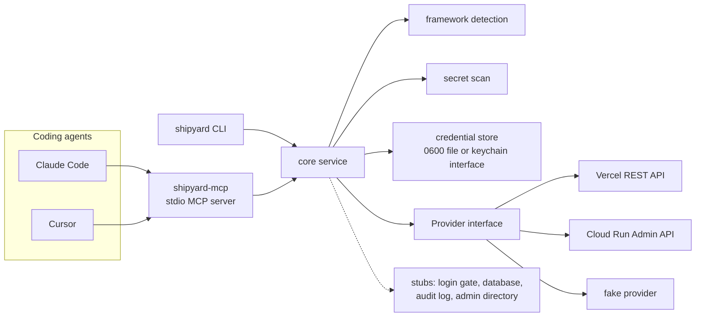

# Shipyard

With one command, or one prompt to a coding agent, an app built in an afternoon becomes a shareable internal tool.

People build internal tools with Claude Code, Cursor, or Lovable, then get stuck on the part that is not the app: deploying it, adding login, keeping secrets out of the repo, and taking backups. IT cannot see the app, and cannot approve it. Shipyard is a cloud for that small software. It does not host anything itself. It deploys onto a Vercel or Google Cloud account the company already has, behind one provider interface.

This repository is the first skeleton: a Go core, a CLI, and an MCP server that coding agents can call.

## Architecture



The CLI and the MCP server call the same core. The core detects Next.js, Vite, Python, or Node, scans the tree for credentials, and calls a `Provider`. Vercel uses the deployments REST API. Cloud Run uses the generated Go clients for the Cloud Run Admin API and Cloud Logging. The fake provider records the app locally so you can try the flow without a cloud account.

The default region is `europe-west1`. Vercel maps EU locations to `arn1` (Stockholm).

## Connect your own account

Shipyard does not create Vercel or Google accounts.

Automatic account creation would break the providers' terms and be blocked by captchas and KYC checks. `ProvisionAccount` is a stub that returns `ErrNotSupported` on every provider. An operator connects an account they already own:

- a Vercel API token, or an OAuth code exchange
- a GCP access token or a service-account JSON key for an existing project, or an OAuth code exchange

Tokens are stored in a file created with mode `0600` under the shipyard config directory (`$XDG_CONFIG_HOME/shipyard`, or `SHIPYARD_HOME`). An OS keychain interface exists and returns "not implemented". The company still pays its own cloud bill, on the free tier where that applies. Shipyard never holds the hosting account.

The tradeoff is setup. Someone has to create the token or the service account once. In return, the deploy stays inside an account IT already governs, and a later admin view can list those apps without Shipyard becoming a second cloud.

## What works in this skeleton

| Piece | Today |
| --- | --- |
| `shipyard` CLI: `deploy`, `status`, `logs`, `secrets set`, `apps`, `connect` | Works |
| `shipyard-mcp` tools: `deploy`, `status`, `logs`, `set_secret`, `list_apps` | Works, stdio |
| Fake provider | Works, local JSON state, no network |
| Vercel client: create deployment, list deployments, events, projects, env, OAuth URL and code exchange | Real HTTP client, tested with `httptest` |
| Cloud Run client: create or update a service, get, list, logs, env update, OAuth URL and code exchange | Go API clients, tested with `httptest` |
| Framework detection | Next.js, Vite, Python, Node |
| Secret scan on deploy | Regex pass; deploy stops on a match |
| Credential file | Mode `0600` |
| EU default region | `europe-west1`, Vercel `arn1` |
| Login gate | Stub. Google Workspace or Microsoft sign-in, limited to the company domain |
| Database per app and backups | Stub |
| Audit log | In-memory only, so the call is wired. Not durable |
| Admin directory of apps and owners | Stub |
| OS keychain | Stub |
| `ProvisionAccount` | Stub, returns `ErrNotSupported` |

Cloud Run deploys need a container image (`--image`). This skeleton does not build or push images, and it does not create GCP projects. New services are created with internal ingress and without a public invoker binding. The login gate that should sit in front of them is not built yet.

A deploy to `vercel` or `gcp` calls that provider. The default provider is `fake`, and the tests never call the production hosts.

## Quickstart

Requires Go 1.27 or newer. The MCP server uses the official Go SDK, `github.com/modelcontextprotocol/go-sdk` (v1.8.0, protocol 2026-07-28).

```bash
make build
./bin/shipyard connect fake
./bin/shipyard deploy hello --dir ./examples/hello
./bin/shipyard status hello
./bin/shipyard logs hello
./bin/shipyard secrets set hello API_KEY --value 'replace-me'
./bin/shipyard apps
```

`connect fake` only writes a local marker. The URL it prints, `https://hello.fake.shipyard.local`, is not a real site.

### MCP

Build `shipyard-mcp` and point Claude Code or Cursor at the binary. The server reads the same config directory as the CLI, so connect a provider in the CLI first. Logs go to stderr. stdout is the MCP protocol.

Claude Code, `.mcp.json` at the project root:

```json
{
  "mcpServers": {
    "shipyard": {
      "command": "/absolute/path/to/shipyard-mcp"
    }
  }
}
```

Cursor, `.cursor/mcp.json`:

```json
{
  "mcpServers": {
    "shipyard": {
      "command": "/absolute/path/to/shipyard-mcp"
    }
  }
}
```

Then ask the agent to deploy the project. It should call `deploy`. For a dry run, say to use the fake provider.

### A real provider

Create a token in the account you already own. Placeholders live in `.env.example`. Do not commit a real token.

```bash
export VERCEL_TOKEN=...   # from .env, not from this repo
./bin/shipyard connect vercel --token "$VERCEL_TOKEN"
./bin/shipyard deploy hello --provider vercel --dir ./examples/hello

export GCP_PROJECT=your-existing-project
export GCP_TOKEN=...
./bin/shipyard connect gcp --project "$GCP_PROJECT" --token "$GCP_TOKEN"
./bin/shipyard deploy hello --provider gcp --image example.com/hello:1
```

OAuth, when you have registered a client:

```bash
export VERCEL_OAUTH_CLIENT_ID=...
export VERCEL_OAUTH_CLIENT_SECRET=...
./bin/shipyard connect vercel --oauth
./bin/shipyard connect vercel --code CODE
```

`shipyard connect status` prints which providers are connected. It does not print tokens.

### Config

`config.json` in the shipyard config directory:

```json
{
  "region": "europe-west1",
  "defaultProvider": "fake",
  "credentialBackend": "file",
  "orgDomain": "example.com"
}
```

`SHIPYARD_REGION`, `SHIPYARD_PROVIDER`, `SHIPYARD_ORG_DOMAIN`, and `SHIPYARD_HOME` override the file. `orgDomain` is reserved for the login gate and is not enforced yet.

| Configured region | Vercel | Cloud Run |
| --- | --- | --- |
| `europe-west1` (default) and any other `europe-*` | `arn1` | that location |
| `us-central1`, `us-east1`, `us-east4` | `iad1` | that location |
| `us-west1`, `us-west2` | `sfo1` | that location |
| a Vercel code such as `cdg1` | that code | rejected; use a Cloud Run location |

## Development

```bash
make build
make test
make vet
make lint    # golangci-lint v2.15.0
```

`make ci` is what GitHub Actions runs: build, vet, test, lint. CI does not deploy.

Tests use the fake provider or `httptest`. They do not call `api.vercel.com` or `*.googleapis.com`.

## Roadmap

1. Login gate. Google Workspace or Microsoft Entra ID, and a session is accepted only when the email is on the company domain.
2. A stronger secret scan: allowlists, entropy, and fewer false positives. The regex pass already blocks a deploy.
3. One database per app, plus backups and restore, on the account the operator connected.
4. A durable audit log and an admin directory of every app and its owner.
5. OS keychain storage, OAuth state checks, a local redirect listener, and token refresh.
6. Large-file uploads for Vercel, and a Cloud Run path that can take a build without this process pushing an image itself.
7. More providers behind the same interface.

## Validation

The bet is that teams will hand an internal app to Shipyard instead of leaving it on a laptop.

- A landing page and a demo of the fake provider, then a deploy onto a connected account.
- Posts on r/ClaudeAI, r/vibecoding, and Show HN.
- Ten Stockholm startups, shown the MCP flow on an app they already built.

Go when **10 or more real apps** have been handed over, or when **3 or more pricing inquiries** come in. Until then, keep the surface to this skeleton: connect an account you own, deploy, status, logs, secrets, and a list of apps.
